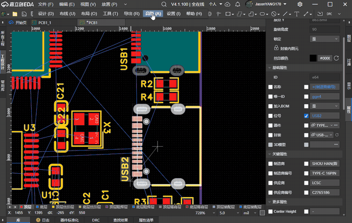
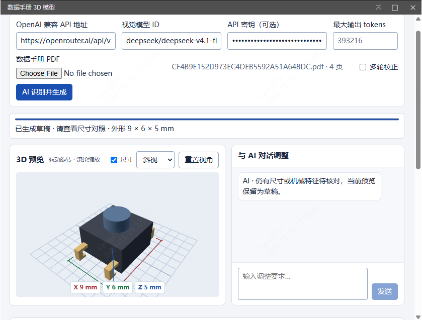
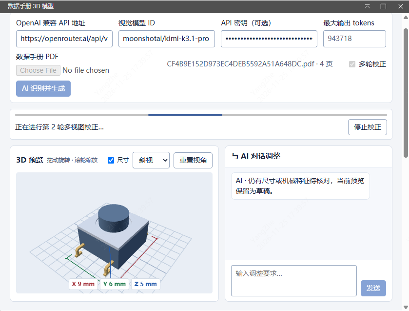
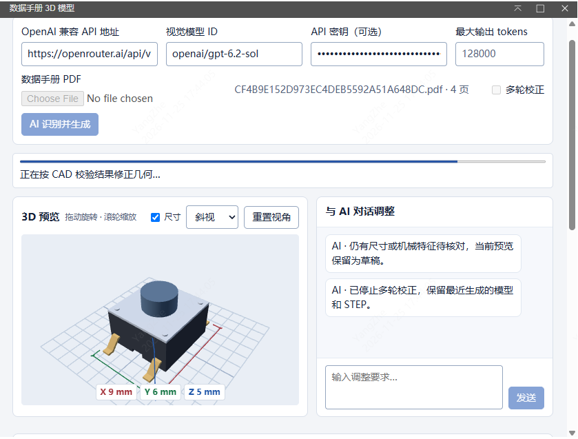
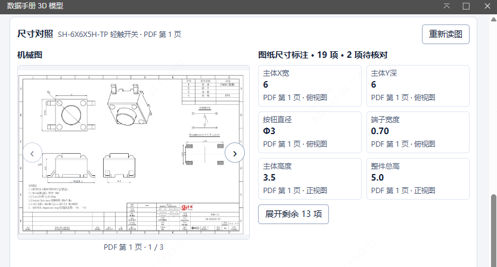
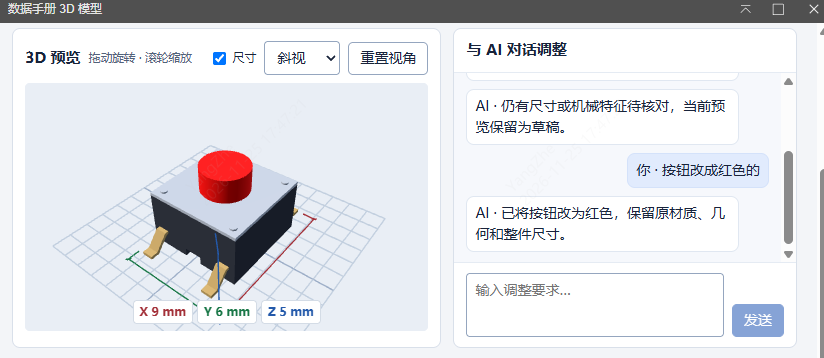
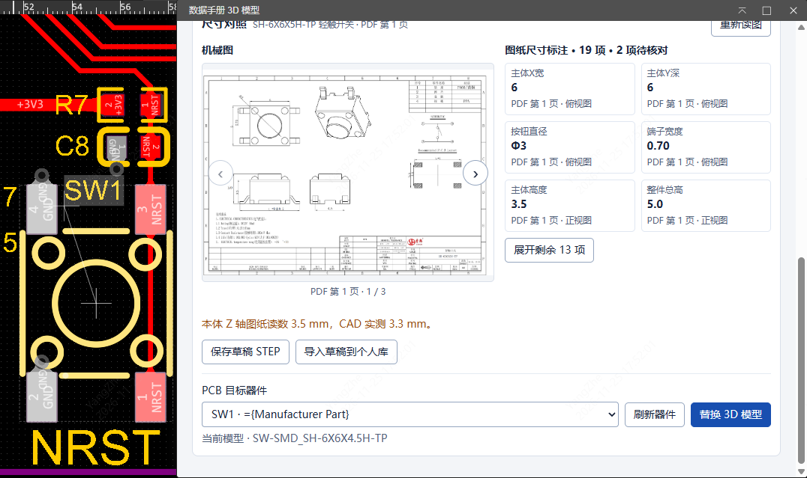
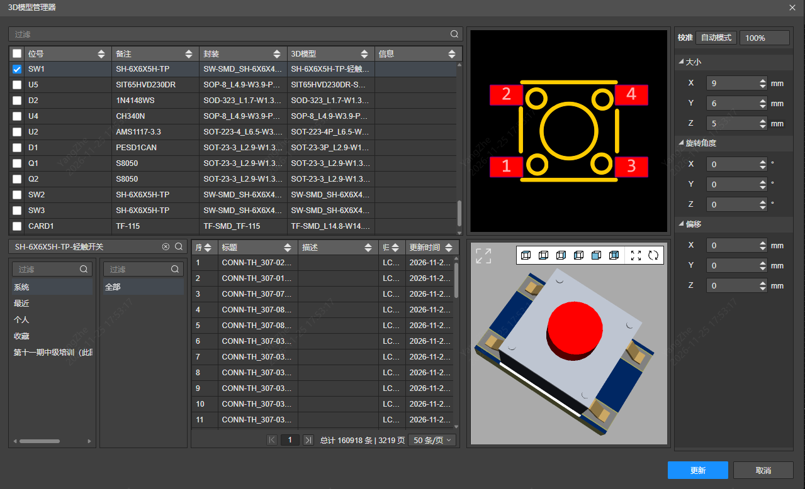

# Datasheet 3D Model

[简体中文](./README.md)

Datasheet 3D Model is an extension for EasyEDA Professional. It reads geometry and dimensions from mechanical drawings in component datasheet PDFs, uses [build123d](https://github.com/gumyr/build123d) to generate STEP models for preview and export, and can bind a generated model to a selected PCB component.



## Example results

| DeepSeek | Kimi | GPT |
| --- | --- | --- |
|  |  |  |

## Locate mechanical drawings

The extension scans candidate pages to find the component drawings, then combines the selected drawing regions in PDF page order. It can read a package outline and its dimension table across multiple pages.



## Generate, preview, and refine in chat

The extension uses CAD operations to build package bodies, holes, openings, sloped surfaces, and terminal arrays. Rotate or zoom the preview, switch views, or display the measured X, Y, and Z dimensions. In chat, you can request changes to geometry, placement, dimensions, color, or the rendered material.



## Export and bind

Save a STEP file, import the model into your personal 3D library, or bind it to a selected PCB component. You can save the model as a draft if dimensions, geometry, or assembly still need review.

| Bind to a selected PCB component | Preview in the 3D Manager |
| --- | --- |
|  |  |

## Installation

1. Obtain `eext-device-model-generator_v1.11.1.eext`. When you build from source, the file is created in `build/dist/`.
2. Import the file from **Advanced → Extension Manager**. Open a PCB or footprint document, then choose **Datasheet 3D Model → Analyze and preview 3D model**.

## Usage

1. Expand **OpenAI-compatible API settings** at the top. Enter an API URL, a vision model ID, and an API key if the service requires one. The URL can be a base URL or the full Chat Completions endpoint. The service must support `image_url` and browser cross-origin requests.
2. Set **Max output tokens** if needed. Leave the field blank to look up and display the published limit for the selected OpenRouter model. This lookup requires no API key. Other services use their server defaults. The extension saves manually entered values. Clear the field to return to Auto.
3. Open the datasheet PDF and select **Analyze and generate**. If the datasheet covers several packages, provide the full part number, package name, or original PDF page number in the chat.
4. Inspect the 3D preview and **Dimensions from drawing**. The arrows switch between selected drawings and their dimensions. PCB pad dimensions are marked separately. Select **Read drawing again** to recheck the selected pages.
5. Describe a change in chat, such as “Enlarge only the mounting hole to the maximum size specified in the drawing” or “Make the button matte red.” You can also enter `Custom dimensions X=3.5 mm, Y=2.8 mm` or `Restore drawing dimensions`.
6. Choose **Save STEP** or **Import to personal library**. In a PCB document, select a reference designator under **PCB target component** and choose **Bind to component**. You can also select one component on the PCB canvas and choose **Refresh components**.

## Build from source

The project follows the directory layout of [pro-api-sdk](https://github.com/easyeda/pro-api-sdk). Node.js 20.17.0 or newer is required.

```sh
npm ci
npm run typecheck
npm run build
```

`npm run build` uses the SDK's compile and packaging scripts to write the `.eext` installation package to `build/dist/`.

| Path | Purpose |
| --- | --- |
| `extension.json` | Extension metadata, entry point, and menus |
| `images/logo.png` | Extension icon referenced by `images.logo` |
| `src/`, `iframe/` | Source for the extension entry point, panel, geometry modeling, and export |
| `locales/` | Simplified Chinese and English resources |
| `config/`, `build/` | Build configuration and packaging script |

## Acknowledgments

- PDF parsing and rendering. [PDF.js](https://github.com/mozilla/pdf.js)
- 3D preview. [Three.js](https://threejs.org/)
- 3D modeling. [build123d](https://github.com/gumyr/build123d)
- Python runtime in the browser. [Pyodide](https://pyodide.org/)
- Open CASCADE geometry kernel. [OCP.wasm](https://github.com/yeicor/OCP.wasm)
