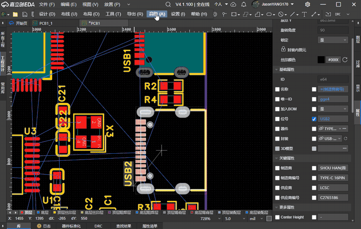
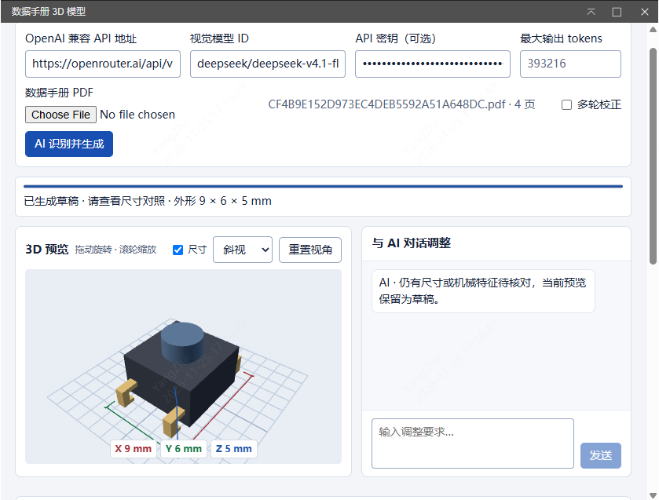
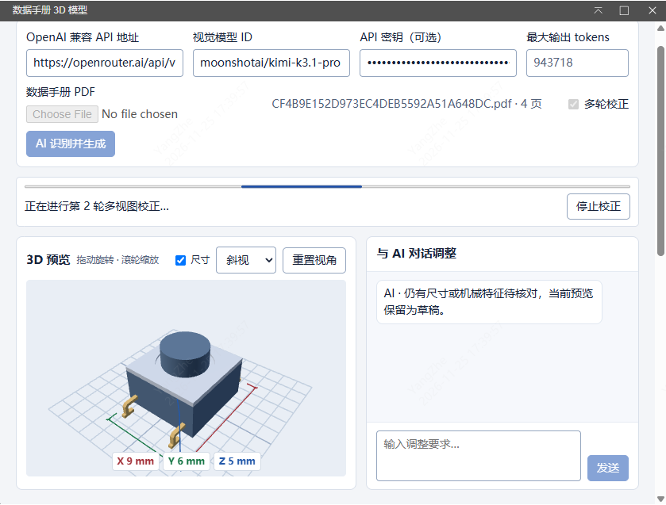
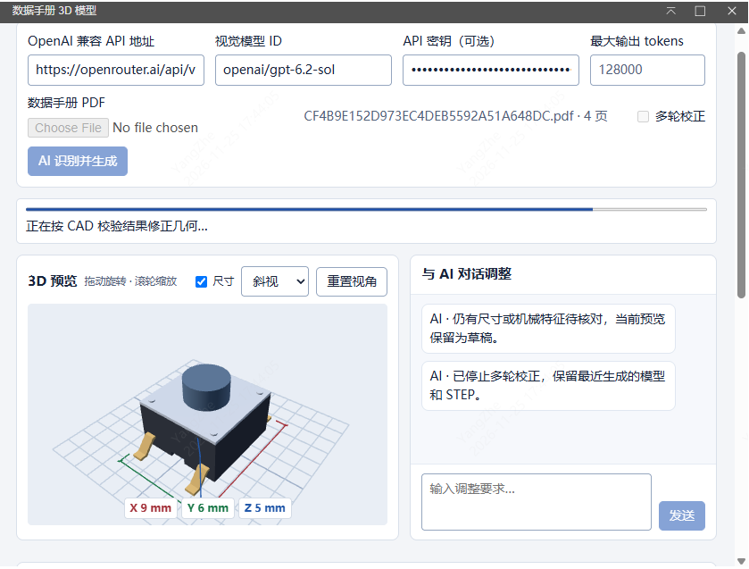
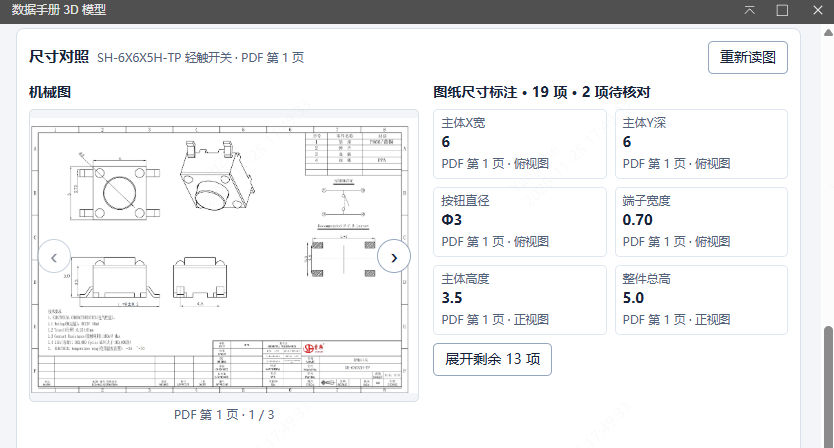
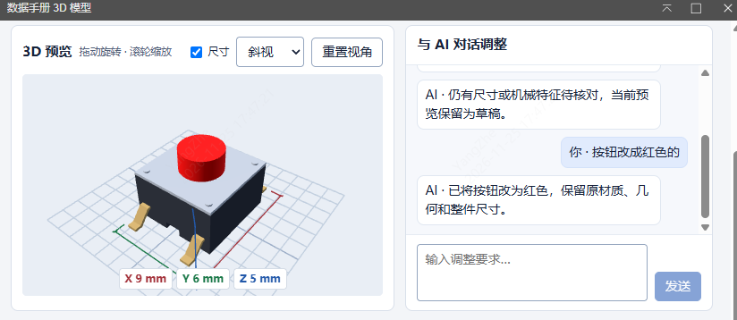
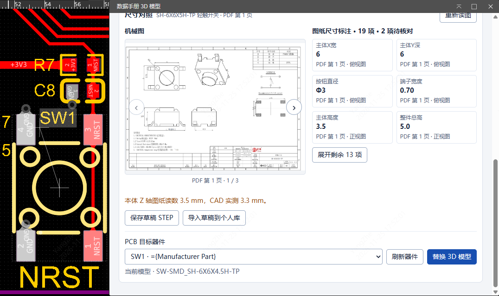
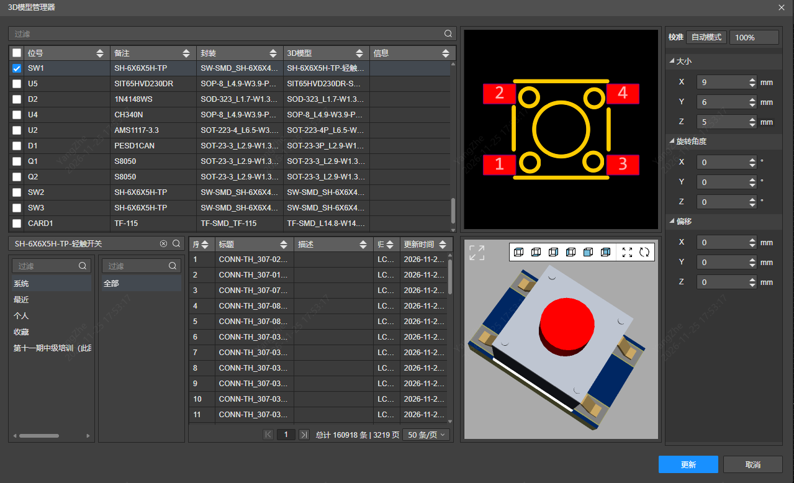

# 器件3D模型生成器

[English](./README.en.md) 

这是一个嘉立创EDA专业版扩展。支持从器件数据手册的 PDF 机械图读取结构和尺寸，用 [build123d](https://github.com/gumyr/build123d) 生成可预览和导出的 STEP 模型，并可将模型绑定到 PCB 中选中的器件。

## 生成效果

| DeepSeek | Kimi | GPT |
| --- | --- | --- |
|   |  |   |

## 定位机械图
用候选页定位器件对应的图纸，按实际 PDF 页码拼接选中的图纸区域。支持将同一封装的外形图和尺寸表跨页读取。

## 生成预览及对话调整
用通用几何操作生成器件外形、孔、开口、斜面和端子阵列。预览支持旋转、缩放、切换视角和显示 CAD 实测 X、Y、Z 尺寸。可以要求修改结构、位置、尺寸、颜色或渲染材质。

## 导出和绑定
保存 STEP、导入个人 3D 库，或在 PCB 中选择器件并绑定模型。仍有尺寸、结构或装配疑点的结果可以作为草稿保存。

| PCB选中绑定 | 3D管理器预览 |
| --- | --- |
|  |   |

## 使用方法

1. 展开顶部的「OpenAI 兼容 API 设置」，填写 API 地址、视觉模型 ID 和服务要求的 API Key。地址可填写 Base URL 或完整的 Chat Completions 地址。服务须支持 `image_url` 和浏览器跨域请求。
2. 按需设置「最大输出 tokens」。留空时，扩展自动查询并显示 OpenRouter 模型公布的上限，查询无需 API Key。其他服务采用服务端默认值。手动设置会保存，清空后恢复自动。
3. 选择数据手册 PDF，点击「AI 识别并生成」。如果资料有多种封装，可在对话框回复完整料号、封装名或指定实际页码。
4. 查看 3D 预览和「尺寸对照」。用箭头切换选中的机械图，右侧同步显示当前图纸的尺寸。PCB 焊盘尺寸会单独标明。点击「重新读图」可复核本次选中的图纸。
5. 通过对话描述调整，例如「只把安装孔按图纸上限放大」或「把按钮改成红色哑光」。也可以输入「自定义整件 X=3.5 mm，Y=2.8 mm」或「恢复图纸尺寸」。
6. 点击「保存 STEP」或「导入个人库」。当前为 PCB 文档时，在「PCB 目标器件」选择位号，再点击「绑定到器件」。也可先在画布中单选器件，然后点击「刷新器件」。

## 致谢

[PDF.js](https://github.com/mozilla/pdf.js) 提供 PDF 解析和渲染能力  
[Three.js](https://threejs.org/) 提供 3D 预览能力  
[build123d](https://github.com/gumyr/build123d) 提供模型构建能力  
[Pyodide](https://pyodide.org/) 提供浏览器能运行Python支持能力  
[OCP.wasm](https://github.com/yeicor/OCP.wasm) 提供Open CASCADE几何内核能力
